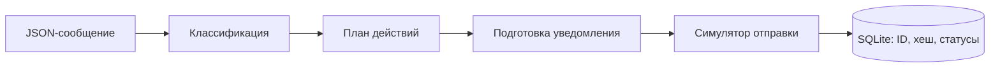

# Автоматизация уведомлений

Небольшой автономный проект на Python для обработки входящих сообщений и симуляции адресных уведомлений. Сообщение проходит через классификацию, планирование действий, выбор получателя и запись результата в SQLite. Проект создан в октябре 2026 года как отдельный пример; он не содержит кода рабочего Watson / Agent Automation.

Подход к разделению этих этапов вырос из моей работы над Watson / Agent Automation. Я разрабатываю Watson с применением AI-assisted programming. Этот репозиторий показывает самостоятельную, упрощённую реализацию без подключения к его инфраструктуре.

## Возможности

- Три явных типа сообщения: `Объявление:`, `Напоминание:` и `Срочно:`. Неизвестный формат не создаёт уведомление.
- Выбор синтетических получателей по аудитории; срочное сообщение также направляется `demo-operators`.
- Симуляция отправки без сети и внешних аккаунтов.
- Повтор неудавшегося действия без повторной отправки успешного.
- Отклонение сообщения, если его ID уже использован с другим содержимым или аудиторией.

## Технологии и устройство

Python 3.10+, стандартная библиотека, SQLite и `unittest`. Сторонних зависимостей нет.



Исходный текст не записывается в базу: там хранятся ID, хеш текста и аудитории, категория, статусы и число попыток. Подробности — в [описании архитектуры](docs/architecture.md).

## Запуск

Из корня репозитория:

```bash
python3 -m automation_portfolio --input examples/data/messages.json --state demo-state.sqlite3
```

Повторите команду с тем же файлом состояния: уже выполненные действия будут пропущены. Для проверки ошибки и последующего повтора:

```bash
python3 -m automation_portfolio --input examples/data/messages.json --state failure-demo.sqlite3 --fail-recipient demo-operators
python3 -m automation_portfolio --input examples/data/messages.json --state failure-demo.sqlite3
```

Первый вызов с намеренным сбоем завершится с кодом `1`, второй выполнит только неудавшееся действие. Файлы `*.sqlite3` исключены из Git.

## Тесты

```bash
python3 -m unittest discover -s tests -v
```

Тесты проверяют классификацию, маршрутизацию, защиту от повторов после перезапуска, повтор неудачного действия, конфликт ID, валидацию и работу CLI.

## Структура

```text
automation_portfolio/   обработка сообщений и CLI
docs/                   архитектура и обработка данных
examples/data/          синтетический JSON-ввод
tests/                  автоматические тесты
```

## Ограничения

Классификация основана на префиксах, без ML-модели. Получатели вымышленные, а «отправка» только записывается в память процесса и выводится в JSON-отчёт. Реальная доставка и гарантия «ровно один раз» для внешнего API здесь не реализованы. Используйте только синтетический ввод: CLI выводит подготовленный текст сообщения. Подробнее о данных и границах примера — в [документации](docs/security.md).
